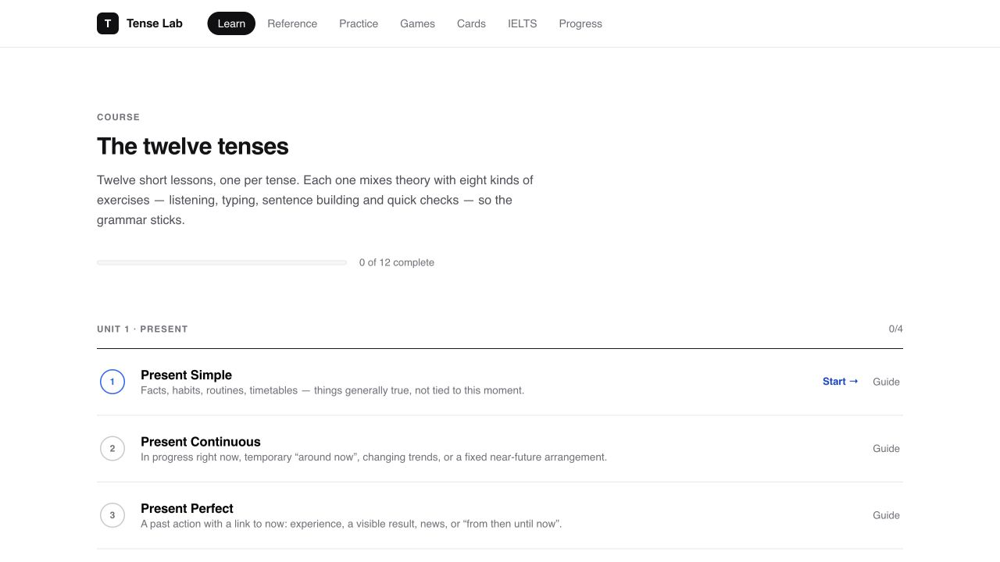

# Tense Lab

An interactive study tool for the twelve English tenses. Short lessons, focused drills and grammar games turn the rules into practice, with explanations after each answer and progress saved in the browser.

[Try Tense Lab](https://english-tenses-grammar-trainer.vercel.app/) · [Download the source](https://github.com/blvgor/tense-lab/archive/refs/heads/main.zip)



## What you can do

- **Learn:** follow twelve guided lessons with theory, sentence building, listening and answer checks.
- **Reference:** compare tense forms, timelines, signal words and common mistakes.
- **Practice:** choose a drill type and a session of 10, 20 or 40 questions; review the explanation for each answer.
- **Games:** try a timed Sprint, Match pairs or Survival.
- **Flashcards:** review tense triggers, irregular verbs and signal words with spaced repetition.
- **IELTS:** explore grammar examples for Writing and Speaking, then practise with exam contexts.
- **Progress:** track accuracy, completed lessons, flashcards and personal bests.

## Run locally

Requires Python 3 and a modern browser. There are no npm dependencies, build steps or accounts to configure.

```bash
git clone https://github.com/blvgor/tense-lab.git
cd tense-lab
python3 -m http.server 4173 --bind 127.0.0.1
```

Open [http://127.0.0.1:4173](http://127.0.0.1:4173). Alternatively, download the ZIP above, extract it and run the same Python command inside the extracted folder.

## Project structure

| File | Purpose |
| --- | --- |
| `index.html` / `styles.css` | Page structure and presentation |
| `app.js` | Navigation, practice, games, flashcards and progress |
| `lessons.js` | Guided lesson content and interactions |
| `data-tenses.js` | Tense definitions and reference material |
| `data-questions.js` | Practice question bank |
| `data-cards.js` | Flashcard decks |
| `data-ielts.js` | IELTS examples and exercises |
| `vercel.json` | Static hosting configuration |

## Browser behaviour

Progress is stored in `localStorage` on the current browser and device. Clearing site data removes that progress; there is no account sync. Listening exercises use browser speech synthesis, so the available voices depend on the browser and operating system. Google Fonts supplies the interface typeface.

Exercises are in English, with occasional explanations in Russian. The IELTS section is independent practice material and does not guarantee an exam score.

Designed and built by [Egor Belyakov](https://github.com/blvgor). [Behance](https://www.behance.net/blvgor) · [LinkedIn](https://www.linkedin.com/in/belyakovuk/)
